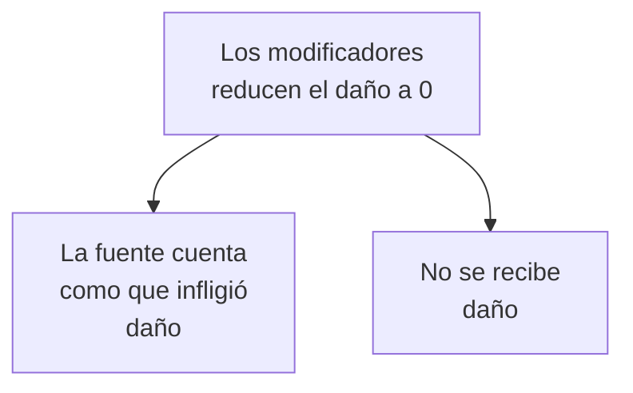

## 1.9. Daño (Damage)

### 1.9.1. Contadores de daño

El daño sobre personajes o localizaciones se representa mediante contadores de daño (*damage counters*). Cada contador suele representar 1 punto de daño; si un contador representa más de 1, equivale a ese número de contadores individuales.

### 1.9.2. Operaciones con el daño

#### 1.9.2.1. Infligir daño (*deal*)

Colocar contadores durante un desafío o por un efecto que inflige daño.

#### 1.9.2.2. Poner daño (*put*)

Colocar contadores directamente mediante un efecto.

#### 1.9.2.3. Retirar daño (*remove*)

Quitar contadores mediante un efecto.

#### 1.9.2.4. Mover daño (*move*)

Retirar una cantidad de contadores de un personaje o una localización y poner esa misma cantidad sobre otro personaje o localización. El mismo efecto no puede volver a poner el daño que mueve sobre la carta de la que se retiró.

### 1.9.3. Recibir daño

Un personaje o una localización recibe daño siempre que se le coloca daño por cualquier medio. En el [glosario de CR 2.3.0, pp. 50 y 52](https://files.disneylorcana.com/CRUpdate_EN_Oct-2026.pdf#page=50), *is/was damaged* equivale a *takes/took damage*. Para el daño infligido que se reduce a 0, véase 1.9.5.

### 1.9.4. Cálculo del daño

El daño se produce por un desafío o por la resolución de un efecto. Para calcular la cantidad total:

1. Se determina el daño base. En un efecto, es la cantidad indicada por su texto; en un desafío, es la Fuerza {S} del personaje.
2. Se aplican al daño base todos los modificadores de daño, en cualquier orden.
3. **La cantidad de daño infligido es el resultado final tras aplicar todos los modificadores, incluido Resist.** Esa es la cifra que se usa al preguntar cuánto daño se ha infligido. Se colocan los contadores correspondientes según el desafío (4.6.6.2) o el efecto (6.7.2.2). Todo el daño procedente del mismo desafío o del mismo efecto ocurre simultáneamente.

> **Ejemplo:** *Smash* tiene daño base 3. Si el personaje elegido tiene Resist +3, el modificador reduce la cantidad total a 0 y no se coloca ningún contador.

### 1.9.5. Daño reducido a 0

Si un personaje o un efecto fuera a infligir daño y los modificadores lo reducen a 0, la fuente sigue considerándose una fuente que ha «infligido daño». Ese evento aporta 0 al total y el personaje o la localización afectados no reciben daño.

Esta distinción puede hacer que se dispare una habilidad que comprueba si una acción infligió daño, aunque el objeto afectado no haya recibido daño.

> [!WARNING] Redacción oficial ambigua
> El ejemplo de la regla 1.9.5 dice que *Smash* «deals 3 damage» después de que Resist +3 haya reducido a 0 la cantidad total calculada. El principio normativo —la fuente sigue considerándose que inflige daño y el objeto no recibe daño— es claro, pero el valor numérico de esa frase debe tratarse con cautela. Véase el informe editorial de CR 2.2.

### 1.9.6. Abandonar el juego

Cuando un personaje o una localización con daño abandona el juego por cualquier motivo, todos sus contadores de daño dejan de existir.

#damage #damage-calculation #dealt-damage #put-damage #remove-damage #move-damage #take-damage #zone-leaving
