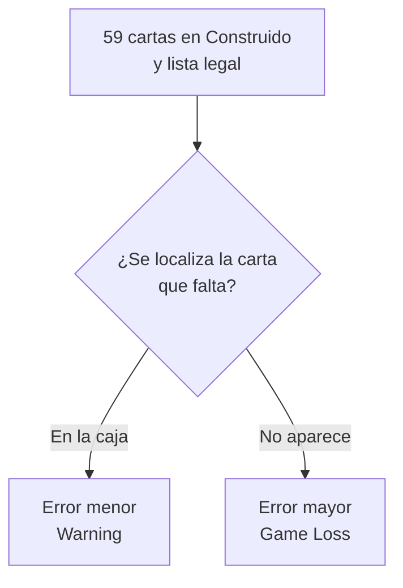

# Deck check: discrepancias entre lista y mazo

**No todo error de mazo implica Game Loss.** El Lore Guide investiga tanto el mazo presentado como la lista registrada; la lista es la referencia de lo que el jugador pretendía jugar. La legalidad del mazo físico por sí sola no determina el remedio.

## Error menor: PCG 3.3

La medida base es Warning. Si el mazo es ilegal pero la lista es legal, se modifica el mazo para ajustarlo a la lista. Por ejemplo, una carta ausente de un mazo de Construido de 59 cartas puede recuperarse si está en la caja. También se retiran las copias que excedan el límite; si eso deja el mazo por debajo del mínimo, el error pasa a mayor.

Que mazo y lista sean legales pero distintos aparece entre los ejemplos de error menor. Sin embargo, **si hay que modificar la lista por cualquier motivo**, PCG 3.3 remite a error mayor. No existe una corrección gratuita de la lista solo porque el mazo físico sea legal.

## Error mayor: PCG 3.4

La medida base es Game Loss. Incluye una lista que debe cambiarse para reflejar el mazo, un mazo de Construido de 59 cartas cuya carta ausente no se encuentra, o más de dos tintas. El remedio depende del defecto concreto: se corrigen las tintas o se consiguen cartas para alcanzar el mínimo; el juez puede emitir Ink Card Proxies si no pueden conseguirse las cartas necesarias. Si después se consiguen las cartas originales, puede recuperarse la composición registrada sin una nueva penalización.

**Ejemplo de las 59 cartas en Construido.** Si la lista registrada es legal, encontrar en la caja la carta que falta permite ajustar el mazo a esa lista. Si no se puede localizar la carta, el error es mayor.

## Legalidad y comunicación

En Construido se requieren al menos 60 cartas, un máximo de dos tintas y hasta cuatro copias por **nombre completo inglés**, incluida la versión. También se comprueban la rotación y las prohibiciones del formato concreto. Véanse [[1.3. Formatos de Torneo]] y [[1.6 Legalidad de Sets (Set Legality)]].

Ante una discrepancia, llama al Lore Guide y conserva mazo y lista para la investigación. No cambies ninguno por tu cuenta. Las PCG distinguen error menor y mayor y contemplan escalamiento por reiteración; no es correcto resumirlas como «siempre Game Loss».

## Referencias

- [Play Correction Guidelines, 3.3–3.4, pp.9–10](https://files.disneylorcana.com/Disney_Lorcana_Play_Correction_Guidelines_052124update.pdf#page=9), efectivas el 21/05/2024.
- [Tournament Rules, 1.3.1 y 3.8–3.9, pp.5 y 19–20](https://files.disneylorcana.com/Tournament-Rules-7.14.2026_Update_EN.pdf#page=19), efectivas el 14/07/2026.
