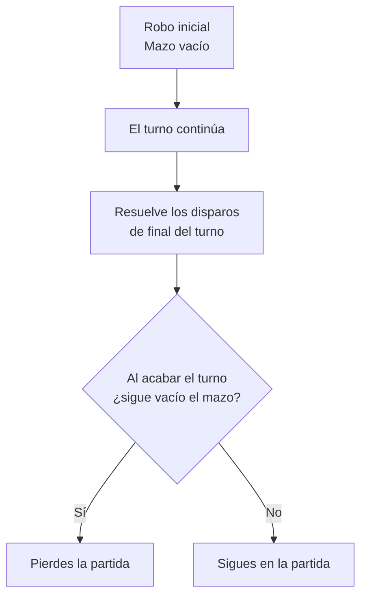

## ❓ Duda

¿Pierdo por empezar mi turno con el mazo vacío o por intentar robar sin cartas? Si después juego [Maleficent & Diablo - Evil Incarnate](https://cards.lorcast.io/card/digital/large/crd_db9e9bd72a5c4aca98bc66a4a9b15499.avif?1783190856) mediante Shift usando **FOOLS!**, ¿puedo seguir en la partida?

Tengo la carta en la mano, una base legal de Shift en juego y cinco cartas de personaje en el descarte.

---

## ✅ Respuesta

**Sí, si conservas al menos una carta en el mazo cuando termina tu turno.** La derrota por mazo vacío se comprueba en ese momento. No poder robar antes no crea una derrota pendiente ni obliga a repetir ese robo después.

FOOLS! exige las **cinco cartas de personaje** y una base legal de Shift llamada Maleficent o Diablo. Las cinco cartas van al fondo de tu mazo en el orden que elijas; no se baraja. No basta con devolver menos ni con jugar el personaje pagando su coste normal.

1. Empiezas con el mazo vacío y no puedes realizar el robo inicial. Continúas hasta la fase principal.
2. Haces Shift mediante FOOLS!, dejando **5 cartas** en el mazo.
3. Si terminas así, no pierdes por mazo vacío. Si después agotas legalmente al personaje y resuelves RAVEN'S CALL una vez, quedan **4 cartas** y tampoco pierdes. El Shift por sí solo no dispara RAVEN'S CALL.
4. Al finalizar el turno se resuelven los disparos correspondientes y después se comprueba el mazo: con cero cartas pierdes, salvo que la partida ya haya terminado antes.

**Variante con [A Whole New World](https://cards.lorcast.io/card/digital/large/crd_3a299da6bf864690a188f07aeb55ffdf.avif?1709690747):** si la resuelves después de FOOLS! y solo quedan esas cinco cartas, descartas la mano y robas las cinco disponibles de una en una; los dos robos restantes no pueden hacerse. Si no añades cartas después y la partida llega al final de tu turno, pierdes por mazo vacío.

---

## 📘 Referencias

### Wiki de Lorcana

- [[01. Reglas/1. Principios generales/1.8. Chequeo del estado del juego (Game State Check)|Cuándo se comprueba el estado del juego y se destierran los personajes]]
- [[01. Reglas/3. Estructura del turno (Turn Structure)/3.2. Fase inicial del turno (Start-of-Turn Phase)|Preparar las cartas y resolver el comienzo del turno]]
- [[01. Reglas/1. Principios generales/1.12 Robo (Drawing)|Diferencias entre robar y poner una carta en la mano]]
- [[01. Reglas/3. Estructura del turno (Turn Structure)/3.4. Fase final de turno (End-of-Phase)|Resolver las habilidades y las comprobaciones al finalizar el turno]]
- [[01. Reglas/8. Palabras clave (Keywords)/8.10. Cambio (Shift)|Coste alternativo, estados y pilas creadas con Cambio]]
- [[01. Reglas/6. Habilidades, efectos y resolución (abilities, effects, and resolving)/6.2. Habilidades Disparadas (Triggered Abilities)|Cuándo se disparan las habilidades y se comprueban sus condiciones]]
- [[01. Reglas/11. Casos de ejemplo y aclaraciones/11.6. Interacciones Complejas/GSC y el final de partida|Cuándo termina la partida y deja de resolverse la bolsa]]

### Texto de las cartas

- 8.10.1 — Coste alternativo de Shift y [texto de FOOLS!](https://cards.lorcast.io/card/digital/large/crd_db9e9bd72a5c4aca98bc66a4a9b15499.avif?1783190856): la carta permite devolver cinco personajes del descarte para hacer Shift gratis sobre un personaje propio llamado Maleficent o Diablo.

### Fuentes oficiales

- [CR 1.2.3 — Hacer todo lo posible](https://files.disneylorcana.com/CRUpdate_EN_Oct-2026.pdf): un efecto de robo se resuelve hasta donde sea posible.
Fuente normativa: [Comprehensive Rules 2.3.0](https://files.disneylorcana.com/CRUpdate_EN_Oct-2026.pdf), reglas 1.2.3 (p. 3), 1.8.1.2 y 1.8.5 (pp. 6–7), 1.12.1–1.12.2 (p. 9), 3.2.3 y 3.4 (p. 11), 6.2.3 (p. 30) y 8.10.1 (p. 42). Los enlaces castellanos sirven de localización; prevalece el PDF inglés.

---

## 🏷️ Tags

#defeat #empty-deck #end-of-turn #gsc #shift #timing
