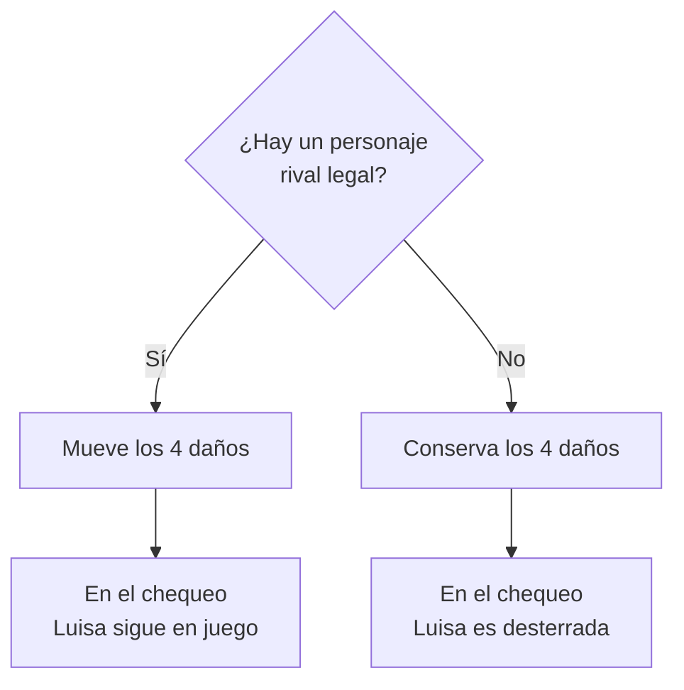

## ❓ Duda

**Luisa Madrigal – Confident Climber** (Wilds Unknown) tiene la habilidad activada:

> **I CAN TAKE IT** 1{I} – Move up to 1 damage from chosen character of yours to this character. Then, if this character has 3 or more damage, move all damage from this character to chosen opposing character.

¿Cómo funciona exactamente esta habilidad y qué ocurre en las casuísticas habituales: mover 0 o 1 daño, alcanzar 3 daños, alcanzar daño letal, no tener personaje rival disponible, interactuar con Resist o generar habilidades por daño?

---

## ✅ Respuesta

**Si Luisa es tu único personaje**, puedes resolver la primera instrucción sin mover daño. No se mueve daño de una carta sobre sí misma. La segunda instrucción no depende de haber movido 1: si Luisa ya tiene 3 o más daños y existe un personaje rival legal, mueve su daño a ese rival.

**I Can Take It** es una única habilidad activada con **dos instrucciones secuenciales** dentro de la misma resolución.

Primero eliges un personaje tuyo y mueves **0 o 1** daño desde ese personaje a Luisa. Después, **solo en ese momento**, compruebas si Luisa tiene **3 o más** daños. Si la condición es verdadera, eliges un personaje rival y mueves **todo** el daño de Luisa a ese personaje.

El **GSC** no ocurre entre ambas instrucciones, sino **después** de que toda la habilidad termina de resolverse. Por eso, si Luisa llega a daño letal en la primera instrucción pero luego mueve todo ese daño fuera de sí en la segunda, **sobrevive**.

Además, el daño movido al personaje rival **sí cuenta como daño recibido**, pero **no** como daño infligido a efectos de **Resist**, así que Resist no lo reduce.

El punto clave con **Ward** es este: **Ward no impide activar la habilidad**. Lo único que impide es **elegir** esa carta cuando la segunda instrucción llega a resolverse. Por tanto, puedes anunciar y pagar **I Can Take It** aunque el único personaje rival tenga Ward; simplemente, si Luisa llega a la segunda instrucción y sigue sin existir un personaje rival legal que puedas elegir, esa parte no hará nada.

---

## 🧪 Casuísticas frecuentes

| Situación | Resultado | Motivo |
|---|---|---|
| Luisa tiene **0 o 1** daños y mueves **1** hacia ella | Luisa se queda en **1 o 2** daños y **no** hay segunda parte | La condición de **3 o más** no se cumple |
| Luisa tiene **2** daños y mueves **1** hacia ella | Luisa llega a **3**, luego mueve **los 3** a un personaje rival | La condición se comprueba después de la primera instrucción |
| Luisa tiene **3** daños de **4** de Willpower y mueves **1** | Luisa pasa a **4**, luego mueve **los 4** fuera de sí y **sobrevive** | El GSC ocurre solo al final de toda la resolución |
| El personaje elegido tiene **0** daños | La primera instrucción mueve **0**; sigue siendo una resolución legal | No hace falta que el origen esté dañado |
| Luisa ya tenía **3 o más** daños antes de activar la habilidad | Aunque la primera instrucción mueva **0**, la segunda puede ocurrir igualmente | La condición mira el estado real de Luisa al llegar a esa parte |
| Hay varios personajes rivales y **uno tiene Ward** | El personaje con Ward **no puede ser elegido**; si hay otro rival legal sin Ward, debes elegir entre esos personajes legales | Ward impide que el oponente elija esa carta al resolver un efecto |
| El **único** personaje rival disponible tiene **Ward** | **Sí puedes activar la habilidad**, pero la segunda instrucción no puede realizarse y Luisa conserva su daño | Ward no impide activar; impide elegir ese personaje cuando llega la segunda instrucción |
| Al llegar a la segunda instrucción **no existe personaje rival legal** | Esa parte no puede realizarse; Luisa conserva su daño | Se resuelve el efecto **tanto como sea posible** en orden |
| El personaje rival tiene **Resist** | El daño movido **no se reduce** | Resist solo reduce daño **infligido**, no daño **movido o puesto** |
| El personaje rival tiene una habilidad del tipo **“whenever this character is damaged”** | Esa habilidad sí puede dispararse | Recibir daño incluye daño **movido** |

---

## 🔄 Secuencia ejemplo con daño letal

| Paso | Acción | Estado de Luisa |
|---|---|---|
| 1 | Pagar **1{I}** | 3 daño |
| 2 | Elegir un personaje tuyo para la primera instrucción | 3 daño |
| 3 | Mover **1** daño a Luisa | **4 daño** (= Willpower) |
| 4 | Comprobar `if this character has 3 or more damage` | 4 daño, condición verdadera |
| 5 | Elegir personaje rival y moverle **todo** el daño de Luisa | **0 daño** |
| 6 | La habilidad termina de resolverse | 0 daño |
| 7 | Se hace el **GSC** | Luisa no se destierra |

**Con 4 de Voluntad y 4 daños tras la primera instrucción**

---

## 📘 Referencias

### Wiki de Lorcana

- [[01. Reglas/6. Habilidades, efectos y resolución (abilities, effects, and resolving)/6.3. Habilidades Activadas (Activated Abilities)|Cuándo pueden usarse las habilidades activadas]]
- [[01. Reglas/4. Acciones de turno (Turn Actions)/4.4. Usar una habilidad activada (Use an Activated Ability)|Anunciar una habilidad activada, pagarla y resolverla]]
- [[01. Reglas/6. Habilidades, efectos y resolución (abilities, effects, and resolving)/6.1. General (General)|Elecciones y resolución de instrucciones]]
- [[01. Reglas/6. Habilidades, efectos y resolución (abilities, effects, and resolving)/6.7. Resolución de Cartas y Efectos (Resolving Cards and Effects)|Resolver las instrucciones y esperar antes de resolver nuevos disparos]]
- [[01. Reglas/1. Principios generales/1.7. Game Actions, Timing, y Illegal Actions|Acciones ilegales y corrección de elecciones]]
- [[01. Reglas/1. Principios generales/1.9. Daño (Damage)|Infligir, poner, mover y recibir daño]]
- [[01. Reglas/8. Palabras clave (Keywords)/8.15 Protección (ward)|Qué personajes impide elegir Protección]]
- [[01. Reglas/8. Palabras clave (Keywords)/8.8. Resistir (Resist)|Qué daño reduce Resistir y qué ocurre al reducirlo a cero]]
- [[01. Reglas/11. Casos de ejemplo y aclaraciones/11.0. Timing y Resolución/Resolución parcial sin objetivo válido|Resolución parcial sin objetivo válido]]
- [[01. Reglas/11. Casos de ejemplo y aclaraciones/11.0. Timing y Resolución/No tener objetivo legal vs elegir un objetivo inválido|No tener objetivo legal vs elegir un objetivo inválido]]
- [[01. Reglas/11. Casos de ejemplo y aclaraciones/11.6. Interacciones Complejas/Mover daño no es retirar daño|Cómo mover daño retira contadores y puede generar disparos]]
- [[01. Reglas/11. Casos de ejemplo y aclaraciones/11.5. Keywords/El uso de Then|El uso de Then]]
- [[01. Reglas/11. Casos de ejemplo y aclaraciones/11.6. Interacciones Complejas/Luisa Madrigal - No Pressure y Casa Madrigal - Courtyard|El chequeo entre dos disparos: por qué una curación posterior puede llegar tarde]]

---

## 🏷️ Tags

#gsc #activated-ability #move-damage #resist #resolution #timing
